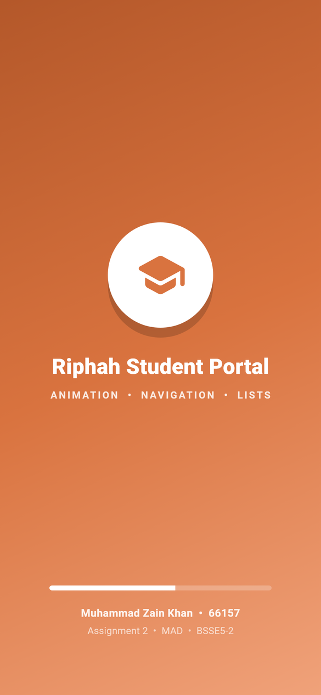
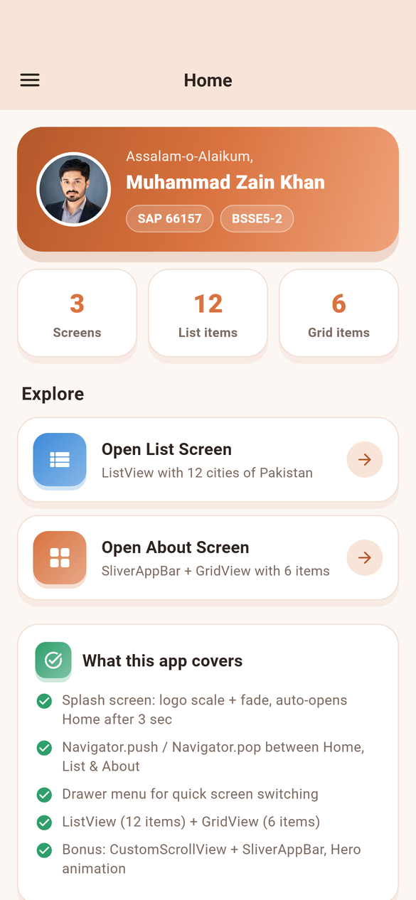
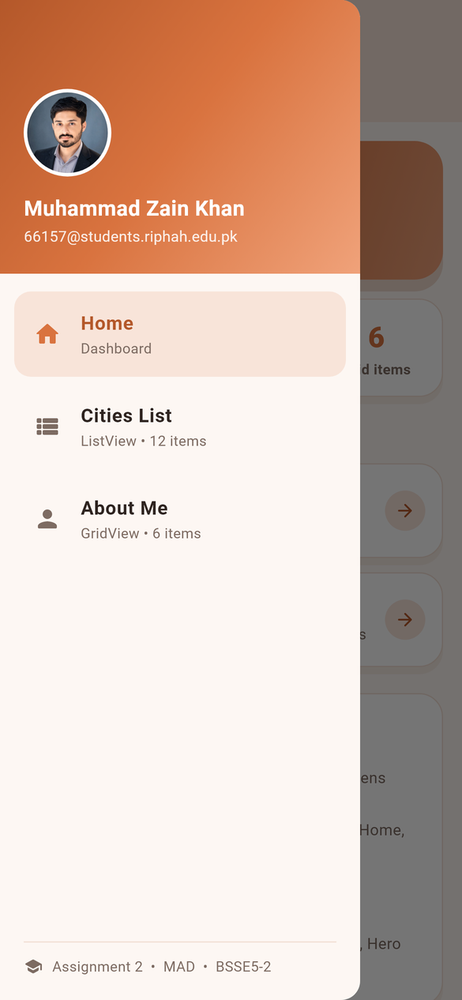
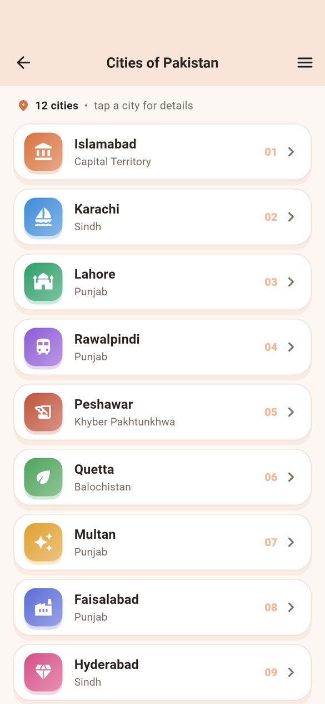
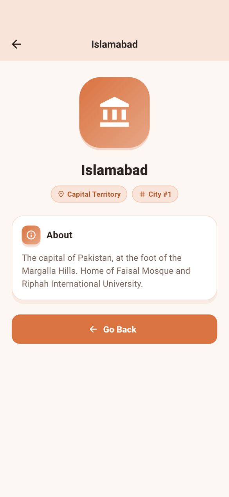
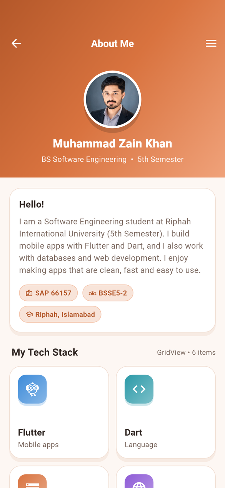
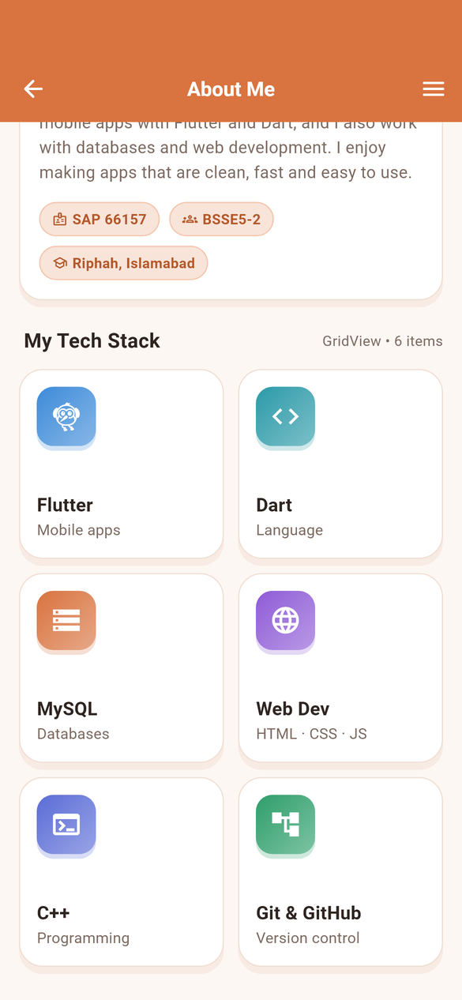
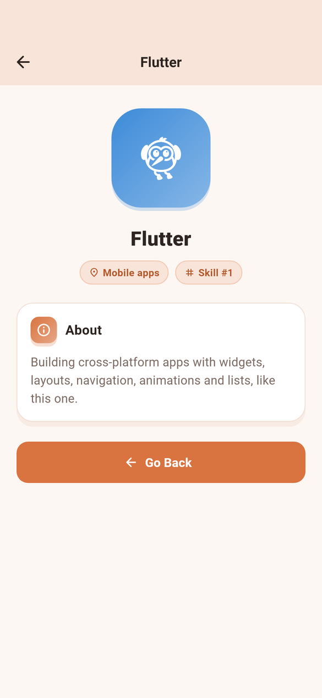
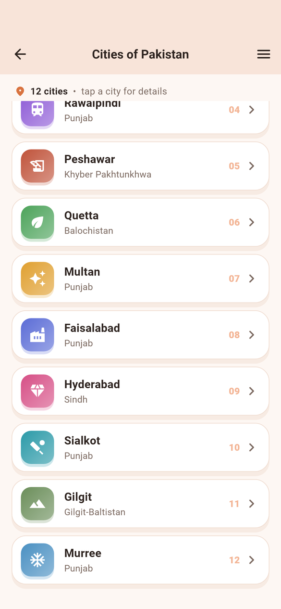

# MAD — Mobile Application Development (Flutter)

**Muhammad Zain Khan** · SAP 66157 · BSSE5-2 · Riphah International University, Islamabad

Weekly Flutter work for the MAD course: a Student Portal app (login, profile, animations, bottom navigation, courses) and **Assignment 2**.

---

## Assignment 2 — Animation, Navigation & Scrollable Lists

| Requirement | Where |
|---|---|
| Splash screen with animation (logo scale + fade), opens Home after **3 seconds** | `lib/assignment_2/splash_screen.dart` |
| Three screens: **Home**, **List**, **About** | `home_screen.dart`, `list_screen.dart`, `about_screen.dart` |
| `Navigator.push` / `Navigator.pop` between screens | Home cards, list/grid items, back buttons |
| **Drawer menu** for quick switching | `app_drawer.dart` |
| **ListView** with 12 items (cities of Pakistan) | `list_screen.dart` |
| **GridView** with 6 items (tech stack) | `about_screen.dart` |
| Bonus: **CustomScrollView + SliverAppBar** | `about_screen.dart` |
| Extra: Hero animation, staggered list animation, fade page transitions | `detail_screen.dart`, `a2_theme.dart` |

### Run

```bash
flutter pub get
flutter run -t lib/main_assignment2.dart        # Assignment 2 on its own
```

Inside the Student Portal app, the 🚀 button on the Profile screen also opens Assignment 2.

### Screenshots

```bash
flutter test test/assignment2_screenshots_test.dart   # walks the whole flow and saves PNGs to test/screenshots/
```

| Splash | Home | Drawer |
|---|---|---|
|  |  |  |

| List (ListView) | Detail (Hero) | About (SliverAppBar) |
|---|---|---|
|  |  |  |

| About (GridView) | Grid item detail | List scrolled |
|---|---|---|
|  |  |  |
